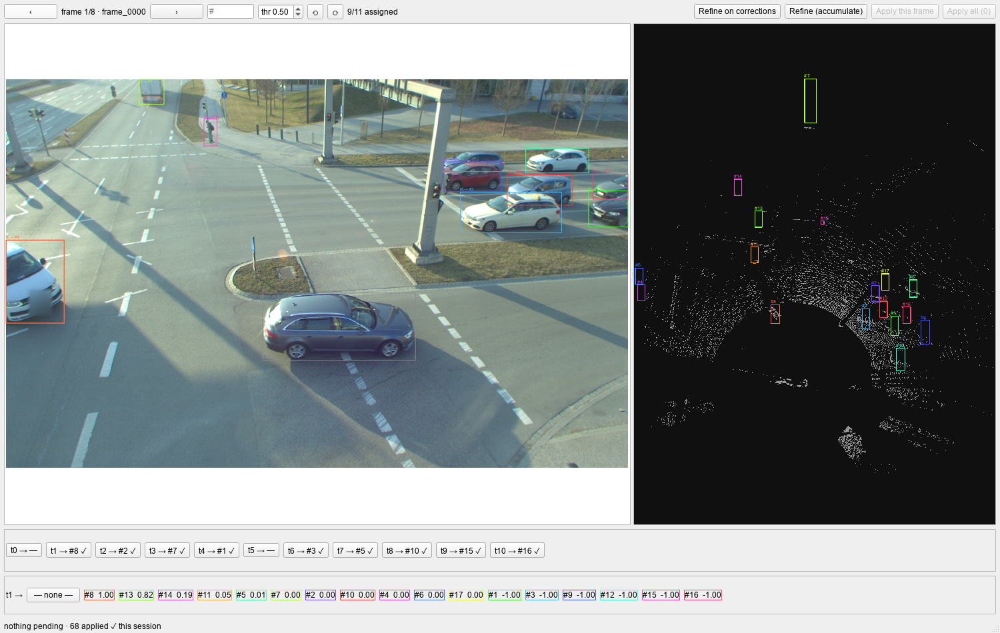
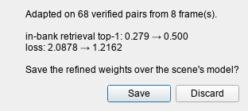
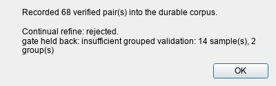

# Review GUI

`xcalib-review` is a Qt window for checking the camera↔LiDAR pairs the matcher proposes.
You step through the frames of one scene, fix the wrong pairs, write your decisions into the
label files, and feed the verified pairs back into the matcher.

The window is optional. `import xcalib` and `import xcalib.continual` never import PySide6,
and the scene helpers the window is built on (`Scene`, `match_review`) run without Qt.

## Install

```bash
pip install "XCalib[gui]"
```

The `gui` extra installs PySide6 (6.6 or newer, below 7). Without it, `xcalib-review` stops
with an `ImportError` that points at the extra. Nothing else in the package needs it.

## Start the window

```bash
xcalib-review --scene /data/MySite --camera cam_front
```

| Argument   | Meaning                                                                          |
| ---------- | -------------------------------------------------------------------------------- |
| `--scene`  | Scene directory, laid out as [below](#scene-layout). Required.                   |
| `--camera` | Camera name: the folder under `camera/`. Required.                               |
| `--device` | torch device for the matcher, for example `cpu`. Default: chosen automatically.  |

The scene directory must exist. The command exits with status 2 and prints
`no lidar frames found under <scene>/lidar` when `lidar/` holds no `.pcd`, `.bin` or `.npy`
files.

The window opens at once and loads the matcher in a background thread; the first frame
appears when the matcher is ready. To start it from Python:

```python
from PySide6.QtWidgets import QApplication
from xcalib.gui import Scene
from xcalib.gui.review import ReviewWindow

app = QApplication.instance() or QApplication([])
window = ReviewWindow(Scene("/data/MySite", "cam_front"), device="cpu")
window.show()
app.exec()
```

[`demo/refine_unification.ipynb`](https://github.com/radar-lab/XCalib/blob/main/demo/refine_unification.ipynb)
opens the same window from a notebook cell.

!!! warning "Windows: the process or the notebook kernel dies at the first match"
    Two causes show up in a conda or pixi environment that was started without activation, for
    example by an editor's interpreter picker. The first NumPy matrix product ends the process with
    exit code `0xC06D007F` when the environment's `Library\bin` folder is not on `PATH`. A mix of
    conda and pip packages can also load two OpenMP runtimes and abort with
    `OMP: Error #15: Initializing libomp.dll, but found libiomp5md.dll already initialized`.
    Activation fixes both, and the pixi environments of this repository set
    `KMP_DUPLICATE_LIB_OK=TRUE` for you, so start `xcalib-review` through `pixi run`. The two
    notebooks fill in both in their setup cell. Without activation, put `<env>\Library\bin` on `PATH`
    and set that variable before you start `xcalib-review`. It is an unsupported OpenMP workaround,
    so prefer an environment with one runtime when you can.

## Scene layout

The window reads and writes one directory per scene:

```text
<data_root>/<scene>/
  camera/<camera>/<frame>.png                  camera image (.png, .jpg or .jpeg)
  lidar/<frame>.pcd                            point cloud (.pcd, .npy or .bin)
  label/<frame>.json                           LiDAR boxes
  label_fusion/camera/<camera>/<frame>.json    camera rects and their pairs
  calib/camera/<camera>.json                   optional: intrinsics and extrinsics
  calib/xcalib/<camera>_model/                 the matcher to review with
```

The frame list is the sorted file names (without extension) in `lidar/`; the image and the two
label files of a frame share its name. Pass `<data_root>/<scene>` as `--scene`: refine takes its
parent folder as the data root and its folder name as the scene name (see
[Continual refine](continual-refine.md)).

**LiDAR boxes** (`label/<frame>.json`). `obj_id` is the id camera rects are paired to. `psr`
holds the box centre (`position`), size (`scale`) and Euler rotation in radians (`rotation`),
all in the LiDAR frame. Entries without `psr` are ignored.

```json
{"objs": [{"obj_id": "7", "obj_type": "Car",
           "psr": {"position": {"x": 12.4, "y": -3.1, "z": 0.8},
                   "scale": {"x": 4.5, "y": 1.9, "z": 1.6},
                   "rotation": {"x": 0, "y": 0, "z": 0.12}}}]}
```

**Camera rects** (`label_fusion/camera/<camera>/<frame>.json`). `rect` is in pixels.
`obj_attr: "t<N>"` is the camera's own track id; rects without one are numbered `@<index>`.
`obj_id` is the paired LiDAR box and stays empty until you accept a pair. `no_match: true`
marks a rect you rejected. Entries without `rect` are ignored.

```json
{"objs": [{"rect": {"x1": 792, "y1": 660, "x2": 1264, "y2": 867},
           "obj_attr": "t3", "obj_id": "", "obj_type": "Car"}]}
```

**Calibration** (optional). `intrinsic` is the row-major 3×3 camera matrix and `extrinsic` the
row-major 4×4 LiDAR-to-camera transform. Give exactly 9 and 16 numbers. The extrinsic below
is a rotation-only placeholder; use your own.

```json
{"intrinsic": [1418.0, 0, 976.0, 0, 1422.0, 606.0, 0, 0, 1],
 "extrinsic": [0, -1, 0, 0, 0, 0, -1, 0, 1, 0, 0, 0, 0, 0, 0, 1]}
```

With a calibration, the window projects each LiDAR box centre into the image and checks it
against the rect. A candidate that projects behind the camera, or farther from the rect than
`max(150 px, 3 × the rect diagonal)`, is flagged ⚠, listed after the compatible ones, and not
suggested. If a rect fails the check against every box, none of its candidates is flagged.
Without a calibration there is no geometry check and no pixel distance.

**Point clouds.** `.pcd` files can be ASCII or binary (binary needs 4-byte fields) and must have
`x`, `y`, `z`; an `intensity` field is kept. `.npy` files are `[P, 3]` or `[P, 4+]` arrays and
keep their first four columns. A `.bin` file is read as `x, y, z, intensity` floats, with the
column count guessed from the file size, so use `.pcd` or `.npy` for clouds without intensity.
The matcher uses `x, y, z` only; intensity is for display.

**Matcher.** `calib/xcalib/<camera>_model/` must hold the matcher the window loads: the first
`*.pth` file in alphabetical order, whose name without the extension is the model name
(`crlite.pth` is `crlite`). A `<model>.yaml` beside it is its config; without one the packaged
`a9_dataset_r02_s01` config for that model name is used. `Matcher.save_pretrained` writes both
files:

```python
matcher.save_pretrained("/data/MySite/calib/xcalib/cam_front_model")
```

If the folder has no checkpoint, the window still opens and the status bar names the path it
looked in. The durable corpus (`refine.sqlite`) lives in the same folder.

To create a scene from your own frames, [`SceneRecorder`](#build-a-scene-from-your-own-frames)
writes this layout from the arrays you pass to `match()`.

## What the window shows

The toolbar sits above the camera image with its 2D rects (left) and the top-down LiDAR view
(right). Below them is one card per camera rect, and a candidate row appears under the cards
when you select one.



*Frame 1 of 8 of the committed A9 sample, after **Apply this frame** on every frame. Card `t1` is
selected, so its candidate row is open under the cards. Cards with `✓` are saved in the label
files, and `t0` and `t5` have no pair.*

| Control                          | What it does                                                                                                                                |
| -------------------------------- | ------------------------------------------------------------------------------------------------------------------------------------------- |
| `‹` `›`                          | Previous or next frame. The Left and Right arrow keys step too, but not while a button, the `thr` box, the `#` box or the image view holds the keyboard focus. |
| `#` box                          | Type a frame number (counting from 1) and press Enter to jump to it.                                                                        |
| `thr`                            | Score threshold for the suggestions, 0 to 1, default 0.50. Changing it re-matches the frame. The candidate lists do not change.             |
| `⟲` `⟳`                          | Rotate the top-down view 15° counter-clockwise or clockwise about the centroid of the cloud. The angle is kept when you change frame.      |
| `Apply this frame`, `Apply all`  | Write pending decisions into the label files. The count of pending decisions is in the button text.                                         |
| `Refine on corrections`, `Refine (accumulate)` | Adapt the matcher from the verified pairs. See [Refine](#refine).                                                             |

Each LiDAR id gets its own color in a frame. A camera rect is drawn in the color of the box it
is paired with, and in gray when it has no pair. In the top-down view at 0° rotation, LiDAR `+x`
points up the screen and `+y` points left, and each box footprint carries its `#id`.

**Intensity.** When the cloud has an intensity column, the top-down view shades each point by
it: the 5th to 95th percentile range maps to gray levels 70 to 255, so weak returns stay
visible. A cloud without intensity is drawn in one flat gray.

**Cards.** Each card reads `t<track> → <pair>`:

| Card text   | Meaning                                                                          |
| ----------- | -------------------------------------------------------------------------------- |
| `t3 → #16`  | Rect `t3` is paired with LiDAR box `16`. The pair is not saved yet.              |
| `✓`         | The pair is already saved in the label file.                                     |
| `—`         | No pair chosen.                                                                  |
| `✗`         | You rejected the rect: it has no match.                                          |
| `⚠`         | The geometry contradicts the pair, or the id has no matchable box in this frame. |

**Correcting a pair.** Click a card, or the rect in the image, to open its candidate row:
`— none —`, then every LiDAR box of the frame that has an `obj_id` as `#id  score`, best first,
with the pixel distance (`889px`) when there is a calibration. Click one to pair it with the
rect. A box belongs to one rect at a time, so picking a box another rect holds takes it from
that rect. `— none —` records a rejection.

A score of `-1.00` is not a score. The matcher ranks only a shortlist of LiDAR boxes for each
rect (`top_k` in the model config, 10 for the released A9 model), and every other box that holds
points shows `-1.00`. Such a box is still listed, so you can pair it by hand.

**LiDAR boxes with no points.** A labelled box whose crop (the box scaled 1.25 times) holds no LiDAR points cannot be scored
by the matcher. It still appears in every candidate row, with score `0.00`, so you can pair it
by hand, for example a pedestrian the LiDAR missed. It is never suggested automatically.

## Apply

Opening a frame fills its cards with what is already saved, then with the matcher's suggestions
(the best one-to-one pairs at or above `thr`). Everything that differs from the saved labels is
a pending decision, and a frame's pending decisions are kept when you step to another frame.

**Apply this frame** and **Apply all** write the pending decisions into
`label_fusion/camera/<camera>/<frame>.json`:

- An accepted pair sets the rect's `obj_id` to the LiDAR id and clears its `no_match` flag.
- A rejection sets `no_match: true` and clears the `obj_id`.
- Applying decisions that are already saved changes nothing.

!!! warning "Suggestions you did not touch are pending too"
    Every frame you open puts its untouched suggestions in the pending count, and **Apply all**
    writes all of them. Check the cards of each frame you visited before you apply.

## Refine

Both refine buttons learn from decisions you have already applied; pending decisions do not
count. They work on the frames that hold at least one verified pair, meaning a camera rect whose
`obj_id` equals the `obj_id` of a LiDAR box in the same frame. Each click uses at most 60 such
frames.

| Button                  | Tier      | What it does                                                                                                                                                                              |
| ----------------------- | --------- | ----------------------------------------------------------------------------------------------------------------------------------------------------------------------------------------- |
| `Refine on corrections` | One-shot  | Banks the verified pairs and adapts the matcher in memory. It needs at least 8 pairs and works with the `crlite` models. A dialog shows retrieval top-1 and loss before and after, and asks whether to save. |
| `Refine (accumulate)`   | Continual | Records every saved pair and every saved rejection of those frames into the durable corpus, then runs the gated `run_continual_refine` over the corpus.                                   |

!!! warning "Save replaces your checkpoint"
    Saving after `Refine on corrections` writes the adapted matcher over the checkpoint in the
    scene's matcher folder. Keep a copy if you want the original.



*`Refine on corrections` on the 68 pairs applied in the sample scene. The top-1 and the loss are
measured on those same pairs, so they show that the matcher learned them, not that it improves on
new frames. **Discard** leaves the checkpoint on disk as it was.*

`Refine (accumulate)` ends with a dialog that reports how many pairs it recorded, the outcome,
the published revision if there is one, the validation score before and after, and the gate's
reasons when it held a candidate back. A published revision is stored under `revisions/` in the
matcher folder and `current.json` points to it. The review window itself always matches with the
checkpoint file in that folder; it does not read `current.json`. The corpus, the gate and its
thresholds are described in [Continual refine](continual-refine.md).



*`Refine (accumulate)` on the same 68 pairs, with the default gate. The validation split holds 14
samples, fewer than the 20 the default gate needs, so it publishes nothing and the matcher you
reviewed with is unchanged.*

## Use the scene API without the window

`Scene` and `match_review` need no Qt. `match_review` runs the matcher on one frame and returns
what the window shows as cards. This example writes one frame of the committed A9 sample (run it
from a repository checkout) into a scene, reviews it, and writes decisions back:

```python
import json
import shutil
from pathlib import Path

from xcalib import Matcher
from xcalib.gui import Scene, match_review

SAMPLE = Path("demo/frames/a9_sample")  # from a repository checkout
ROOT = Path("scene_demo")
CAMERA = "cam"
FRAME = "frame_0000"

# 1. Write one frame in the scene layout.
for sub in (f"camera/{CAMERA}", "lidar", "label", f"label_fusion/camera/{CAMERA}"):
    (ROOT / sub).mkdir(parents=True, exist_ok=True)

det = json.loads((SAMPLE / FRAME / "detections.json").read_text())
shutil.copyfile(SAMPLE / FRAME / "image.png", ROOT / "camera" / CAMERA / f"{FRAME}.png")
shutil.copyfile(SAMPLE / FRAME / "point_cloud.pcd", ROOT / "lidar" / f"{FRAME}.pcd")

# LiDAR boxes: extents (xmin, ymin, zmin, xmax, ymax, zmax) -> centre and size, one id each.
boxes = []
for j, (x0, y0, z0, x1, y1, z1) in enumerate(det["bboxes_3d"]):
    boxes.append({
        "obj_id": str(j + 1),
        "obj_type": "Car",
        "psr": {
            "position": {"x": (x0 + x1) / 2, "y": (y0 + y1) / 2, "z": (z0 + z1) / 2},
            "scale": {"x": x1 - x0, "y": y1 - y0, "z": z1 - z0},
            "rotation": {"x": 0.0, "y": 0.0, "z": 0.0},
        },
    })
(ROOT / "label" / f"{FRAME}.json").write_text(json.dumps({"objs": boxes}))

# Camera rects: no obj_id yet; obj_attr "t<N>" is the camera's own track id.
rects = [
    {"rect": {"x1": a, "y1": b, "x2": c, "y2": d}, "obj_attr": f"t{i}", "obj_type": "Car"}
    for i, (a, b, c, d) in enumerate(det["bboxes_2d"])
]
(ROOT / "label_fusion" / "camera" / CAMERA / f"{FRAME}.json").write_text(
    json.dumps({"objs": rects}))

# 2. Open the scene and review the frame.
scene = Scene(str(ROOT), CAMERA)
matcher = Matcher.from_pretrained("crlite", site="a9_dataset_r02_s01", device="cpu")
review = match_review(matcher, scene, FRAME, threshold=0.3)

print(f"{review.n_rects} camera rects, {review.n_boxes} LiDAR boxes")
for t in review.tracks[:4]:
    best = t.options[0]
    print(f"track {t.key}: suggestion=#{t.suggestion or '-'}  "
          f"best candidate=#{best['lidar_id']} ({best['score']:.2f})")
print("suggestions:", {t.key: t.suggestion for t in review.tracks if t.suggestion})

# Box #17 holds no LiDAR points, so the matcher cannot score it. It is still listed, at 0.0.
print([o for o in review.tracks[3].options if o["lidar_id"] == "17"])

# 3. Write decisions back, as Apply does: accept #16 for track 3, mark track 0 as no match.
t0, t3 = review.tracks[0], review.tracks[3]
print(scene.apply(FRAME, [
    {"rect": t3.rect, "lidar_id": t3.options[0]["lidar_id"]},
    {"rect": t0.rect, "none": True},
]))
```

```text
11 camera rects, 17 LiDAR boxes
track 0: suggestion=#-  best candidate=#10 (1.00)
track 1: suggestion=#8  best candidate=#8 (1.00)
track 2: suggestion=#2  best candidate=#2 (1.00)
track 3: suggestion=#7  best candidate=#16 (1.00)
suggestions: {'1': '8', '2': '2', '3': '7', '4': '1', '6': '3', '7': '5', '8': '10', '9': '15', '10': '16'}
[{'lidar_id': '17', 'lidar_type': 'Car', 'score': 0.0, 'proj_px': None, 'geo_ok': True}]
{'written': 1, 'marked': 1}
```

`match_review(matcher, scene, frame, threshold=0.5)` returns a `FrameReview` with one
`TrackEntry` per camera rect:

| Field        | Meaning                                                                                              |
| ------------ | ---------------------------------------------------------------------------------------------------- |
| `key`        | `"3"` for track `t3`, or `"@<index>"` for a rect without a track id.                                 |
| `rect`       | `[x1, y1, x2, y2]` in pixels.                                                                        |
| `applied_id` | The LiDAR id already saved on the rect, or `""`.                                                     |
| `rejected`   | `True` when the rect is saved as `no_match`.                                                         |
| `suggestion` | The id from the optimal one-to-one assignment at or above `threshold`, or `""`.                      |
| `options`    | Candidates, geometry-compatible first, then by score: `lidar_id`, `lidar_type`, `score`, `proj_px`, `geo_ok`. |

The suggestion is an assignment over the whole frame, so it can differ from a rect's best
candidate. In the output above, `#16` is the best candidate of track 3, but the assignment gives
`#16` to track 10, so track 3 is suggested its next candidate, `#7`. A frame with no camera
rects or no LiDAR boxes returns an empty `tracks` list.

`Scene.apply(frame, decisions)` writes decisions and returns `{"written": n, "marked": m}`. A
decision is `{"rect": [x1, y1, x2, y2], "lidar_id": "<id>"}` to accept a pair, or
`{"rect": [...], "none": True}` to reject the rect.

### Build a scene from your own frames

`SceneRecorder` writes the layout above from the arrays you pass to `match()`. It keeps the
intensity column when the cloud has one, and leaves each rect's `obj_id` empty:

```python
from xcalib import SceneRecorder

rec = SceneRecorder("/data/MySite", camera="cam_front")
rec.save_calibration(calibration)  # optional: a successful CalibrationResult
frame = rec.save_frame(image, point_cloud, bboxes_2d, bboxes_3d)
```

Pass `ids_3d` and `ids_2d` to `save_frame` to use your own LiDAR and track ids. Add
`recorder=rec` to `matcher.oneshot(...)` to save the frames the matcher is lost on. Copy or
save a matcher into `calib/xcalib/cam_front_model/` and the scene is ready for
`xcalib-review`.
