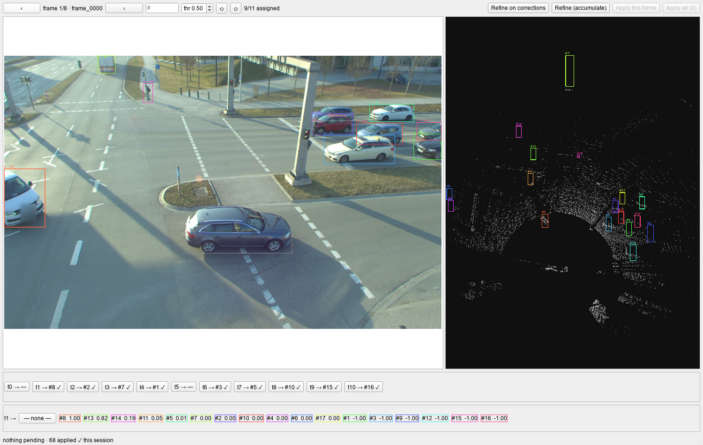

# Review GUI

`xcalib-review` is a Qt window for checking the camera↔LiDAR pairs the matcher proposes.
You step through the frames of one scene, fix the wrong pairs, write your decisions into the
label files, and calibrate from the saved pairs. The window does nothing else: it does not create
or edit boxes, and installing a model and learning from the saved pairs are
[notebook steps](#learning-from-the-saved-pairs).

The window is optional. `import xcalib` and `import xcalib.continual` never import PySide6,
and the scene helpers the window is built on (`Scene`, `match_review`) run without Qt.

## Install

```bash
pip install "XCalib[gui]"
```

The `gui` extra installs PySide6 (6.6 or newer, below 7). Without it, `xcalib-review` stops
with an `ImportError` that points at the extra. Nothing else in the package needs it.
Exporting the saved pairs and training need the `train` extra as well:
`pip install "XCalib[gui,train]"`.

## Start the window

```bash
xcalib-review --scene /data/MySite --camera cam_front
```

| Argument   | Meaning                                                                          |
| ---------- | -------------------------------------------------------------------------------- |
| `--scene`  | Scene directory, laid out as [below](#scene-layout). Required.                   |
| `--camera` | Camera name: the folder under `camera/`. Required.                               |
| `--device` | torch device for the matcher, for example `cpu`. Default: chosen automatically.  |
| `--notebook-workflow` | **Calibrate** takes the intrinsics saved in the scene instead of asking for them, see [Scene layout](#scene-layout). Optional. |
| `--proposals` | JSON file of pairs for a person to confirm, see [Apply](#apply). Optional.    |
| `--check`  | JSON file of camera boxes to look at, see [Apply](#apply). Optional.             |
| `--only-listed` | Step through the frames named by `--proposals` and `--check` alone. Optional. |
| `--context N` | With `--only-listed`, also step through `N` frames before and after each listed frame. |
| `--accept-calibration` | Save a **Calibrate** / **Recalibrate** result that passes the automatic checks without asking. Optional. |

The scene directory must exist. The command exits with status 2 and prints
`no lidar frames found under <scene>/lidar` when `lidar/` holds no `.pcd`, `.bin` or `.npy`
files.

The homography notebook,
[`demo/xcalib_homography_en.ipynb`](https://github.com/radar-lab/XCalib/blob/main/demo/xcalib_homography_en.ipynb),
takes a raw delivery to saved pairs, a pairing model and the
[homography](#the-homography-from-the-saved-pairs). `pixi run notebook-homography`, run in
`demo/`, registers the kernel the notebook names, "XCalib demo (.pixi)", and opens the notebook.
Its pairing steps open this window with `--notebook-workflow`.

Without a trained matcher the window offers manual pairing. In a scene imported by the
homography notebook, the camera boxes are the delivery's own camera detections and the LiDAR
boxes come from its LiDAR table, both written by the import.

**Calibrate** uses saved positive pairs from all frames. Select an intrinsics
JSON (`intrinsic` is a flat nine-element matrix; optional `distortion` uses
OpenCV ordering), or edit the legacy GUI defaults. These defaults are scaled
from the legacy code's assumed 1280×720 reference; their camera identity is
unverified. Inspect the inlier count and error before saving. **Recalibrate**
refines an existing calibration and offers to save an accepted result. Check
the boxes and the saved pairs before either operation.

With `--accept-calibration` the window saves without that question when no
person needs to judge the result, and shows the inliers and the error in its
status line. A **Calibrate** result has to pass these checks: at least 30
inliers and a third of the pairs, an error below 10 px, and the camera within
100 m of the LiDAR. A **Recalibrate** result that nudges the saved pose
qualifies as it is: the nudge is adopted only when it fits the saved pairs
better than the pose already in the scene. **Recalibrate** takes a fresh solve
instead of the nudge when the fresh solve fits the saved pairs clearly better
and stays within 15° and 5 m of the saved pose; such a result has to pass the
same checks as a **Calibrate** result. When a check fails, the question is
asked as usual and names the failed check.

Vendor LiDAR detections can pre-fill the 3D boxes. Put the perception CSV at
`<scene>/vendor/lidar_perception.csv` (one row per object and frame:
`timestamp` equal to the frame stem, `id`, `position_x/y/z`, `length`, `width`,
`height`, and `heading` in degrees about a vertical z axis; an export with
`x`, `y`, `z` and `yaw` columns is read from those, in metres and radians, and
its `position_x/y` are then longitude and latitude), then run:

```python
from xcalib.gui.lidar_import import label_lidar

report = label_lidar(["/data/scenes/site_base", "/data/scenes/site_refine"])
```

This writes `label/<frame>.json` drafts in the point-cloud frame, with the
vendor track id as `obj_id`. A CSV that is already in the point-cloud frame is
written as is. Otherwise the vendor-to-PCD transform is estimated once from the
first scene. That needs the `primary_sensor` and `distance_to_primary_sensor`
columns, a fixed sensor at the PCD origin, and enough moving traffic. A result
that does not put the moving points inside the boxes raises an error instead of
writing labels; pass a known 4×4 transform as `matrix=` in that case. The
transform and its fit are saved as `vendor/lidar_transform.json`. Boxes with
fewer than `min_points` returns in the frame's cloud are left out, and a label
file a person has edited is never replaced. The drafts are not ground truth:
check them with `preview(scene, frame, camera=...)` from the same module, which
returns an image of the saved camera and LiDAR boxes. Steps 1 and 5 of the homography
notebook (`flow.import_raw("base")`, `flow.import_raw("refine")`) write these drafts and show
three such images.

A model and an extrinsic belong to the LiDAR frame of the scene they were made
in. A later delivery of the same site can hold its point clouds in another
frame, for example the vendor's site frame instead of one sensor's frame. Its
boxes then fit its own clouds, yet the base model pairs almost nothing on it.
Bring such a scene into the base scene's frame while writing the drafts:

```python
report = label_lidar(["/data/scenes/day2_refine"], frame_of="/data/scenes/site_base")
```

The clouds are rewritten (x, y, z only) through the base scene's saved
vendor-to-PCD transform and the boxes follow. Before anything is rewritten, a
sample of the moved clouds must come to lie on the base scene's clouds;
deliveries that do not share a vendor frame are refused and left as they are.
Step 5 of the homography notebook (`flow.import_raw("refine")`) imports a whole
delivery as the refine scene and does this when a base scene was chosen in the
session and recorded its frame; without a base scene the delivery is imported
as it is.
Binary PCD files with mixed field types (float coordinates beside 1- and 2-byte
ring or reflectivity fields) are read directly.

After reviewing pairs, export a derived HDF5 cache with an explicit text file
containing one frame ID per line:

```bash
xcalib-export-scene --scene /data/scenes/site --camera cam_front \
  --frames-file /data/train-frames.txt --output /data/train.h5
```

Only saved positive pairs enter the cache; undecided boxes do not become
negative examples. Prepare separate train and validation frame lists with no
overlap, grouping related tracks or sequences to avoid leakage. The source
scene remains authoritative. Use the existing `pixi run train-hdf5` task on
the caches. Continual refinement is a separate operation. The review window
loads the published revision when it opens.

`xcalib.gui.workflow.prepare_training_caches(scene, run_dir)` exports a whole
scene in one call and
`train_base_from_caches(run_dir, epochs=..., pretrained_dir=..., absolute_scores=...)`
trains on the result; steps 4 and 7 of the homography notebook call both.
The export creates a new output directory, skips and reports frames with
invalid pairs or fewer than two pairs, and uses the first 80% of usable frames
for training and the rest for validation. The notebook exports with
`negatives=True`, which adds each frame's other camera and LiDAR boxes, and
trains with `absolute_scores=True`, which learns absolute scores from them and
writes `score_mode: absolute` into the model (see **Scores** under
[Learning from the saved pairs](#learning-from-the-saved-pairs)). With
`negatives=True` one saved pair is enough when the frame also holds a second
camera box and a second LiDAR box. `split.json` records skipped frames and IDs
present in both splits. A temporal split from one scene can share objects across
splits and is not an independent evaluation. Training writes a new `model/`
folder beside the caches and never touches a scene's model. It runs in a
separate process, with details in `training.log`.

The window opens at once and loads the matcher in a background thread; the first frame
appears when the matcher is ready. To start it from Python:

```python
from PySide6.QtWidgets import QApplication
from xcalib.gui import Scene
from xcalib.gui.review import ReviewWindow

app = QApplication.instance() or QApplication([])
window = ReviewWindow(Scene("/data/MySite", "cam_front"), device="cpu")
window.show()
app.exec()
```

[`demo/refine_unification.ipynb`](https://github.com/radar-lab/XCalib/blob/main/demo/refine_unification.ipynb)
opens the same window from a notebook cell.

!!! warning "Windows: the process or the notebook kernel dies at the first match"
    Two causes show up in a conda or pixi environment that was started without activation, for
    example by an editor's interpreter picker. The first NumPy matrix product ends the process with
    exit code `0xC06D007F` when the environment's `Library\bin` folder is not on `PATH`. A mix of
    conda and pip packages can also load two OpenMP runtimes and abort with
    `OMP: Error #15: Initializing libomp.dll, but found libiomp5md.dll already initialized`.
    Activation fixes both, and the pixi environments of this repository set
    `KMP_DUPLICATE_LIB_OK=TRUE` for you, so start `xcalib-review` through `pixi run`.
    `demo/refine_unification.ipynb` and `demo/xcalib_quickstart.ipynb` fill in both in their setup
    cell. Without activation, put `<env>\Library\bin` on `PATH` and set that variable before you
    start `xcalib-review`. It is an unsupported OpenMP workaround, so prefer an environment with
    one runtime when you can. The demo environment (`demo/pixi.toml`) also sets
    `MKL_THREADING_LAYER=SEQUENTIAL`: without it, NumPy's MKL threads through the OpenMP runtime
    that torch brings, which is too old for it, and the process ends at the first large matrix
    product. Without activation, set it too.

## Scene layout

The window reads and writes one directory per scene:

```text
<data_root>/<scene>/
  camera/<camera>/<frame>.png                  camera image (.png, .jpg or .jpeg)
  lidar/<frame>.pcd                            point cloud (.pcd, .npy or .bin)
  label/<frame>.json                           LiDAR boxes
  label_fusion/camera/<camera>/<frame>.json    camera rects and their pairs
  calib/camera/<camera>.json                   optional: intrinsics and extrinsics
  calib/intrinsic/<camera>.json                optional: intrinsics before the first calibration
  calib/camera_history/<camera>_<time>.json    calibrations that a later save replaced
  calib/xcalib/<camera>_model/                 the matcher to review with
  vendor/lidar_perception.csv                  optional: vendor LiDAR rows for 3D drafts
```

A scene imported by the homography notebook has no extrinsic, so its intrinsics wait in
`calib/intrinsic/`: a reader of `calib/camera/` takes every file there as a finished calibration,
intrinsics and extrinsic together. With `--notebook-workflow`, **Calibrate** reads that file
instead of asking for one, and saving the result writes `calib/camera/<camera>.json` with both
parts.

Saving a calibration never loses the one it replaces: when the extrinsic changes, the file as it
was is first copied to `calib/camera_history/<camera>_<time>.json`. To go back, copy that file
over `calib/camera/<camera>.json`.

The frame list is the sorted file names (without extension) in `lidar/`; the image and the two
label files of a frame share its name. Pass `<data_root>/<scene>` as `--scene`: refine takes its
parent folder as the data root and its folder name as the scene name (see
[Continual refine](continual-refine.md)).

**LiDAR boxes** (`label/<frame>.json`). `obj_id` is the id camera rects are paired to. `psr`
holds the box centre (`position`), size (`scale`) and Euler rotation in radians (`rotation`),
all in the LiDAR frame. Entries without `psr` are ignored.

```json
{"objs": [{"obj_id": "7", "obj_type": "Car",
           "psr": {"position": {"x": 12.4, "y": -3.1, "z": 0.8},
                   "scale": {"x": 4.5, "y": 1.9, "z": 1.6},
                   "rotation": {"x": 0, "y": 0, "z": 0.12}}}]}
```

**Camera rects** (`label_fusion/camera/<camera>/<frame>.json`). `rect` is in pixels.
`obj_attr: "t<N>"` is the camera's own track id; rects without one are numbered `@<index>`.
`obj_id` is the paired LiDAR box and stays empty until you accept a pair. `no_match: true`
marks a rect you rejected. Entries without `rect` are ignored.

```json
{"objs": [{"rect": {"x1": 792, "y1": 660, "x2": 1264, "y2": 867},
           "obj_attr": "t3", "obj_id": "", "obj_type": "Car"}]}
```

**Calibration** (optional). `intrinsic` is the row-major 3×3 camera matrix and `extrinsic` the
row-major 4×4 LiDAR-to-camera transform. Give exactly 9 and 16 numbers. The extrinsic below
is a rotation-only placeholder; use your own.

```json
{"intrinsic": [1418.0, 0, 976.0, 0, 1422.0, 606.0, 0, 0, 1],
 "extrinsic": [0, -1, 0, 0, 0, 0, -1, 0, 1, 0, 0, 0, 0, 0, 0, 1]}
```

With a calibration, the window projects each LiDAR box centre into the image and shows how
far it lands from the rect. A candidate that projects behind the camera, or farther from the
rect than `max(150 px, 3 × the rect diagonal)`, is flagged ⚠. The flag is a hint for the
reviewer and decides nothing: the suggestions come from the matcher's scores alone, so a
flagged candidate is still suggested when the matcher scores it highest. If a rect fails the
check against every box, none of its candidates is flagged. Without a calibration there is no
geometry check and no pixel distance.

**Point clouds.** `.pcd` files can be ASCII or binary (binary needs 4-byte fields) and must have
`x`, `y`, `z`; an `intensity` field is kept. `.npy` files are `[P, 3]` or `[P, 4+]` arrays and
keep their first four columns. A `.bin` file is read as `x, y, z, intensity` floats, with the
column count guessed from the file size, so use `.pcd` or `.npy` for clouds without intensity.
The matcher uses `x, y, z` only; intensity is for display.

**Matcher.** `calib/xcalib/<camera>_model/` must hold the matcher the window loads: the first
`*.pth` file in alphabetical order, whose name without the extension is the model name
(`crlite.pth` is `crlite`). A `<model>.yaml` beside it is its config; without one the packaged
`a9_dataset_r02_s01` config for that model name is used. `Matcher.save_pretrained` writes both
files:

```python
matcher.save_pretrained("/data/MySite/calib/xcalib/cam_front_model")
```

If the folder has no checkpoint, the window still opens for manual pairing.
The durable corpus (`refine.sqlite`) lives in the model folder.

The window has no button for installing a model. `xcalib.gui.workflow.install_new_base(scene,
model_dir)` copies a trained model (`crlite.pth` and `crlite.yaml`) into a scene that has none.
`install_model(scene, model_dir)` also replaces a model that is there: the previous folder is
moved beside the new one as `<camera>_model_replaced_<time>`, with its corpus and revisions.

To create a scene from your own frames, [`SceneRecorder`](#build-a-scene-from-your-own-frames)
writes this layout from the arrays you pass to `match()`.

## What the window shows

The toolbar sits above the camera image with its 2D rects (left) and the top-down LiDAR view
(right). Below them is one card per camera rect, and a candidate row appears under the cards
when you select one.



*Frame 1 of 8 of the committed A9 sample, after **Apply this frame** on every frame. Card `t1` is
selected, so its candidate row is open under the cards. Cards with `✓` are saved in the label
files, and `t0` and `t5` have no pair. The picture is from an earlier version: its two refine
buttons are gone, and **Calibrate**, **Recalibrate** and **Next pending** are in their place.*

| Control                          | What it does                                                                                                                                |
| -------------------------------- | ------------------------------------------------------------------------------------------------------------------------------------------- |
| `‹` `›`                          | Previous or next frame. Left and Right arrows also step while the review window or its image/BEV controls have focus; text fields, spin boxes and dropdowns keep their normal arrow-key behavior. |
| `#` box                          | Type a frame number (counting from 1) and press Enter to jump to it.                                                                        |
| `thr`                            | Score threshold for the suggestions, 0 to 1, default 0.50. Changing it re-matches the frame. The candidate lists do not change.             |
| `⟲` `⟳`                          | Rotate the top-down view 15° counter-clockwise or clockwise about the centroid of the cloud. The angle is kept when you change frame.      |
| `−` `+` `Reset view`             | Zoom the LiDAR view out or in, or reset rotation, zoom and pan. The mouse wheel also zooms; right-drag pans. Dragging empty space rotates. |
| `Apply this frame`, `Apply all`  | Write pending decisions into the label files. The count of pending decisions is in the button text.                                         |
| `Next pending`                   | Go to the next frame with unsaved decisions or a box to check (key `N`).                                                                    |
| `Calibrate`, `Recalibrate`       | Solve the LiDAR-to-camera extrinsic from the saved pairs of all frames, or update the saved one. See [Start the window](#start-the-window). |

Each LiDAR id gets its own color in a frame. A camera rect is drawn in the color of the box it
is paired with, and in gray when it has no pair. In the top-down view at 0° rotation, LiDAR `+x`
points up the screen and `+y` points left, and each box footprint carries its `#id`.

**Intensity.** When the cloud has an intensity column, the top-down view shades each point by
it: the 5th to 95th percentile range maps to gray levels 70 to 255, so weak returns stay
visible. A cloud without intensity is drawn in one flat gray.

**Cards.** Each card reads `t<track> → <pair>`:

| Card text   | Meaning                                                                          |
| ----------- | -------------------------------------------------------------------------------- |
| `t3 → #16`  | Rect `t3` is paired with LiDAR box `16`. The pair is not saved yet.              |
| `✓`         | The pair is already saved in the label file.                                     |
| `—`         | No pair chosen.                                                                  |
| `✗`         | You rejected the rect: it has no match.                                          |
| `⚠`         | The geometry contradicts the pair, or the id has no matchable box in this frame. |

**Correcting a pair.** Click a card, or the rect in the image, to open its candidate row:
`— none —`, then every LiDAR box of the frame that has an `obj_id` as `#id  score`,
ordered by projected pixel distance (`889px`) when there is a calibration. Candidates without a
finite distance appear last, ordered by model score. Click one to pair it with the
rect. A box belongs to one rect at a time, so picking a box another rect holds takes it from
that rect. The previous saved association is cleared when the decisions are applied.
Alternatively, select the camera rect and click a box in the LiDAR view. If a
calibration is available, the selected box's 3D projection is drawn with red
dashed lines on the image. The selected LiDAR box is filled yellow, outlined with a
dark halo, and identified by ID in the toolbar; the candidate button is highlighted too.
`— none —` records a rejection. Press `Q`/`E` to rotate the view, `+`/`-` to zoom,
and `R` to reset it. Drag empty space horizontally with the left button, drag with
the middle button, or hold Shift and drag with the left button to rotate the view
continuously. These controls do not change the LiDAR box annotation.

A score of `-1.00` is not a score. The matcher ranks only a shortlist of LiDAR boxes for each
rect (`top_k` in the model config, 10 for the released A9 model), and every other box that holds
points shows `-1.00`. Such a box is still listed, so you can pair it by hand.

**LiDAR boxes with no points.** A labelled box whose crop (the box scaled 1.25 times) holds no LiDAR points cannot be scored
by the matcher. It still appears in every candidate row, with score `0.00`, so you can pair it
by hand, for example a pedestrian the LiDAR missed. It is never suggested automatically.

## Apply

Opening a frame fills its cards with what is already saved, then with the matcher's suggestions
(the best one-to-one pairs among the candidates it scores at or above `thr`; candidates
under `thr` take no part, and the calibration does not filter anything). Suggestions are labeled
`(proposal)`. A suggestion you leave as it is counts as right: everything a frame shows that
differs from the saved labels is a pending decision, a suggestion as much as a pair you picked.
A frame's pending decisions are kept when you step to another frame.

**Apply this frame** and **Apply all** write the pending decisions into
`label_fusion/camera/<camera>/<frame>.json`:

- An accepted pair sets the rect's `obj_id` to the LiDAR id and clears its `no_match` flag.
- A rejection sets `no_match: true` and clears the `obj_id`.
- Reassigning a saved ID to another camera rect clears the previous association
  without labeling that rect as an explicit no-match.
- Applying decisions that are already saved changes nothing.

!!! warning "Suggestions you did not touch are pending too"
    Every frame you open puts its untouched suggestions in the pending count, and **Apply all**
    writes all of them. Check the cards of each frame you visited before you apply: a wrong
    suggestion that is left as it is becomes a saved pair. A frame that was never opened is not
    touched.

Pairs prepared outside the window can be brought in for confirmation with
`--proposals pairs.json`, where the file maps a frame to the same decisions Apply writes:
`{"<frame>": [{"rect": [x1, y1, x2, y2], "lidar_id": "<id>"}]}`. They open as pending
decisions, marked `(to confirm)` on their cards, and nothing is saved until you apply them;
change or reject a pair first if it is wrong. A pair is ignored when its camera box or LiDAR id
is not in the frame or when it is saved already. When the labels hold the offered LiDAR id on
another camera box of that frame, that box gives the id up in the same Apply, as it does when
you reassign an id by hand. An entry `{"rect": [x1, y1, x2, y2], "none": true}` proposes
instead that the camera box has no LiDAR box, the rejection you would make of a wrong
suggestion: its card reads `✗ (to confirm)` and Apply saves it as an explicit no-match. The
window opens on the first frame that has one, and **Next pending** (key `N`) goes to the next
frame with unsaved decisions.

Saved pairs that someone or something doubts can be listed for a second look with
`--check boxes.json`: `{"<frame>": [{"rect": [x1, y1, x2, y2], "note": "<why>"}]}`. The window
changes and stages nothing for them. It marks each listed camera box `(check)` on its card,
shows the notes above the image, opens on the first listed frame, and **Next pending**
steps through the listed frames as well. An entry without a `rect` marks the whole frame.

Add `--only-listed` to leave every other frame out of the window: the previous and next
buttons then move between the frames named by `--proposals` and `--check`, and the frame box
accepts only their numbers. The frame label keeps the frame's number in the scene and adds its
place in the list, for example `frame 3681/6300 · listed 19/30`. Calibrate and Recalibrate
still use every frame of the scene.

To see what happens just before and after a listed frame, add `--context N`: the window then
also steps through the `N` frames on either side of each listed frame. Such a frame is
labelled with the listed frame it sits beside, for example `frame 3679/6300 · beside listed
19/30`, and **Next pending** still jumps between the listed frames.

## Learning from the saved pairs

The window has no button that changes the matcher. Apply writes decisions into the label files
and nothing more. What learns from them is a notebook step or a function call, where the frames
that go in, the model that comes out and the check in between are in front of you:

| Way | Where | What it does |
| --- | --- | --- |
| Train | Steps 4 and 7 of the homography notebook (`flow.train("base")`, `flow.train("refine")`), or `prepare_training_caches` and `train_base_from_caches` | Trains on the frames of one scene that hold saved pairs: step 4 a new model on the base scene, step 7 the base model further on the refine scene. The result is a new model folder; no model is replaced. |
| Use the result | Steps 6 and 8 of the homography notebook (`flow.pair("refine")`, `flow.pair_remaining("refine")`) | Puts the base model (step 6) or the fine-tuned model (step 8) into the refine scene, keeps the previous one beside it, and opens the window with the model's pairs: in step 6 its suggestions, marked `(proposal)`; in step 8 its pairs for the camera boxes without a decision, marked `(to confirm)`. |
| Continual refine | [`demo/refine_unification.ipynb`](https://github.com/radar-lab/XCalib/blob/main/demo/refine_unification.ipynb), or `record_saved_pairs` and `run_continual_refine` | Records the saved decisions into the durable corpus and publishes a revision only when it beats the serving model on held-out samples. See [Continual refine](continual-refine.md). |

`python -m xcalib.gui.model_pairs --scene /data/MySite --camera cam_front --output pairs.json`
writes what the scene's model suggests for every camera box without a decision, in the
`--proposals` format: the window's own one-to-one suggestion, never a LiDAR box that a
saved pair of the frame already holds. It saves nothing. Open the file with
`xcalib-review --proposals pairs.json --only-listed`, correct what is wrong, and Apply. With
`--check-output doubts.json` it also lists, in the `--check` format, the suggestions the scene's
extrinsic does not support: the projected centre of the suggested LiDAR box lies outside the
camera box, or another LiDAR box projects into it. Those are the ones to look at first; a
suggestion without the mark still needs a look. For a scene without an extrinsic the list is
empty.

**Scores.** The homography notebook trains (steps 4 and 7, `flow.train`) on the saved pairs, on
the other camera boxes of those frames (saved as `— none —` or not decided: both count as having
no LiDAR box), and on the other LiDAR boxes of those frames, with
`trainer.train(none_loss=True)`, and writes `score_mode: absolute` into the model's
`crlite.yaml`. Such a model's score for a candidate is the sigmoid of its second-stage output:
a camera box without a LiDAR box can score every candidate under `thr`, and then it gets no
suggestion. Without that line (`score_mode: relative`, the default, as in the published
weights) each rect's candidates are stretched to 0..1 and its best candidate always scores 1.

!!! note "The refine buttons moved out of the window"
    Earlier versions had two buttons, `Refine on corrections` and `Refine (accumulate)`. The
    one-shot tier is still `matcher.oneshot(...).bank_pairs(...)` and `.adapt()` in Python. Its
    before and after accuracy is measured on the banked pairs themselves, so compare the adapted
    matcher with the original on other frames before you `save_pretrained` it over a model. The
    continual tier is `record_saved_pairs` followed by `run_continual_refine`.

## The homography from the saved pairs

Step 9 of the homography notebook (`flow.homography()`) writes the homography that places the
LiDAR objects in the camera image: `[u, v, 1] ~ H @ [position_x, position_y, 1]` maps a row of
the delivered LiDAR table to the pixel of that object's centre. `H` is fitted to the saved pairs
alone; no extrinsic, camera matrix or model takes part. The step fits one `H` to the saved pairs
of the refine scene of step 5, so it follows the refine part of the notebook, and to those of the
base scene of step 1 as well when Part 1 ran in the same session; the base part is not needed for
it. A homography belongs to one camera position and one LiDAR table, so the base data has to come
from the same camera position: the step prints for each scene how many of its usable pairs agree
with the fit, and warns when fewer than half of a scene's pairs do (at least 10 of them), as when
the camera moved between the two recordings; `flow.homography("refine")` then fits the refine
scene alone. Without a base scene the refine pairs are used alone, and when they do not cover
enough of the image the step says that base data of the same camera completes them.
It writes into a new folder under `runs/` and calls
`xcalib.gui.pair_homography.export_pair_homography(refine, folder, more=[base])` with the two
`Scene`s, or `export_pair_homography(scene, folder)` for one scene. `more` takes further scenes of
the same camera and the same delivered table: their saved pairs join the one fit, and their
frames the marked images.

- **Pairs.** A saved pair gives the `position_x, position_y` of its LiDAR object in the
  delivered table (`vendor/lidar_perception.csv`, a copy of the vendor's file, used as it is)
  and, as the pixel, the centre of its camera box. A scene without a delivered table uses its
  own LiDAR boxes instead, with the x, y of the box centre as the position. The pairs are
  prepared before the fit, because not every right pair is a good point for it:
    - A camera box that reaches the image edge (within 2 px) is left out: its centre is that
      of the visible part, which can lie far from the object's centre.
    - A camera box wider than 8% of the image width is left out. It is an object close to the
      camera, and the centre of such a box lies tens of pixels beside the object's centre, for
      every such object to the same side; left in, these pairs agree with each other and pull
      the fit away from the rest.
    - Each object counts once per image cell of 32 px (one place), so that a parked object
      paired in every frame does not outweigh the rest.
    - The places are taken evenly over the image: at most 25 from each of six image columns,
      from the top of a column to its bottom. Traffic fills one side of an image with places;
      counted as they come, that side alone carries a fit that is far off on the other side.

  All the pairs stay in the labels and in the training data; these rules only choose the
  points of the fit.
- **Fit.** It needs at least 12 saved pairs and 6 places, and the places must span a quarter of
  the image width or more; otherwise nothing is written and the reason is given. A RANSAC fit
  over the places, with a 25 px tolerance, keeps a few wrong pairs from bending `H`, and at
  least 6 places must agree with it. Least squares over the places within 10 px of it then
  refines it when enough of them are. The fit is made in metres: a table that holds longitude
  and latitude in `position_x, position_y` and metres in `x, y` gives the linear map between
  the two itself, and that map is part of `H`.
- **Files.** `homography.json` holds `position_to_image` (`H`), `image_to_position` (its
  inverse), `metres_to_image` (the same fit from the table's `x, y` in metres; equal to `H`
  when `position_x, position_y` are metres), `fitted_to` (what went into the fit, with the
  checks below), the camera matrix saved in the scene (`null` when there is none), zero
  distortion and the image size. The scene's images are rectified, so the saved camera matrix
  with zero distortion describes them. The import expects a rectified delivery: undistorted
  images, with the camera detections made on them. `scripts/undistort_raw_delivery.py` writes a
  rectified copy of a delivery that is not. `projection_inputs.py` gives the values as Python
  assignments for a projection script that reads the delivered images and table: a timestamp of
  the base scene, the image folder, the table, the output folder, the camera matrix, zero
  distortion and `H`; it is written when the scene has a camera matrix.
  `<frame>_rectified_projected.png`, for up to six frames spread over the scenes, is the camera
  image with a red dot and the LiDAR id for every object of that frame that lies in front of the
  camera and inside the image, placed through `H` alone. Without a delivered table, the folder
  also gets `lidar_objects.csv`, the objects in view, and `projection_inputs.py` names it as the
  table. An `H` for longitude and latitude needs all its digits; take it from the files.
- **Checks.** Counted over the saved pairs whose camera box is whole and not wide
  (`usable_boxes` in `fitted_to`): how many box centres lie
  within 25 px of where `H` puts their object, with the median and 95th-percentile distance of
  those, and how many camera boxes hold their object's dot (`inliers`, `median_error_px` and
  `p95_error_px` in `fitted_to`, and `dots_in_paired_camera_boxes`). `thirds` in `fitted_to`
  gives, for the left, middle and right third of the image, the places there and how many of
  them agree with the fit; `cut_by_image_edge` and `wide_boxes` count the pairs left out, and
  `places` the places the fit used. Each entry of `scenes` in `fitted_to` gives a scene's
  `pairs`, `frames`, `usable` (whole and not wide) and `agree` (of those, within 25 px). Step 9
  prints the first two counts, the agreement of each scene, how many pairs were
  left out and why, and warns when a third of the image has too little support: add pairs
  of moving objects there and run the step again. Step 3 (`flow.view_pairs("base")`) shows at
  any time how the saved pairs spread over the left, middle and right of the image.

A homography cannot tell an object behind the camera from one in front and puts both at some
pixel. `H` is scaled so that the third coordinate of `H @ [position_x, position_y, 1]` is
positive for the objects the pairs show, so negative for objects behind the camera. The images
written here leave the objects behind the camera out. The report counts those that would land
inside the image (`behind_camera_but_in_image`), and step 9 warns about them; a script that
draws every row has to skip the negative ones.

## Look at a scene in SUSTechPOINTS

[SUSTechPOINTS](https://github.com/naurril/SUSTechPOINTS) is a 3D annotation tool in the web
browser that reads the [scene layout](#scene-layout): each frame's point cloud with its LiDAR boxes
(`label/`) and their ids, and the camera images. The homography notebook opens it in two optional
cells, `flow.view_sustech("base")` after step 1 and `flow.view_sustech("refine")` after step 5. The
page holds every scene chosen in the session (choose one in the scene list at the top, then a frame
in the frame list beside it, or open the address the cell prints for each scene), opens at the first
frame of the scene named, and stays available while the notebook runs; when the chosen scenes
change, it starts again at a new address. With the mouse over the large view, the left and right
arrow keys go to the previous and the next frame (PageUp and PageDown too). The notebook's page
saves into the scenes: a box fine-tuned there is written into the scene's own `label/` file at
once. The page reaches each scene's files through hard links (a folder on another drive than its
temporary copy is linked as a junction, which the launcher's cleanup removes without following
it). To fine-tune a box, click its name (or one of its lines): three views of it open on the left,
from above, from the side and from behind. Drag a border or a corner there (just inside the line),
or the middle to move the box; a double click on a border pulls it in to the points inside the box,
in the middle every border, so drag a border out first where the box cuts the object. With the
mouse over one of these views, W/A/S/D and the arrow keys move the box; over the view from above,
Q/E turn it. Do not delete a box (Delete, or Ctrl+D over these views) or change its id: the saved
pairs name LiDAR boxes by their ids. Move the mouse off the three views before changing the frame.
The camera image shows
when the camera is chosen in the page's **Camera** menu; without an extrinsic in `calib/camera/`
the page draws no LiDAR box on it. The browser opens from a short-lived process, so restarting the
notebook does not close it.

SUSTechPOINTS is a separate program with its own dependencies and is not installed with XCalib.
The launcher, `scripts/launch_sustech.py`, expects:

- the SUSTechPOINTS code of commit `50fa188` (`50fa18871a6d46507ff9057175669235885f79f9`): the
  submodule `third_party/SUSTechPOINTS`
  (`git submodule add https://github.com/naurril/SUSTechPOINTS.git third_party/SUSTechPOINTS`,
  then that commit checked out in it), or a copy of that commit in `datasets/SUSTechPOINTS`;
- a Python with the packages of its `requirement.txt` and `tf-keras`, by default the virtual
  environment `datasets/sustech-venv`;
- its model `deep_annotation_inference.h5`, by default in `datasets/`.

`datasets/` is ignored by git: these are local runtime assets. To open scenes of your own:

```bash
pixi run sustech -- --scene /data/scenes/site_base --scene /data/scenes/refine/site_refine --view-only
```

`--scene` shows one scene directory; repeat it for several scenes that do not share a folder (their
folder names must differ), or give `--data-root` with a folder of scenes instead. The page opens a
scene directly at `http://127.0.0.1:<port>/?scene=<folder name>&frame=<frame>`. Without
`--view-only` the page saves into the scenes: an edited box is written to their `label/` folder.
`--port` chooses the localhost port (8081 by default); `--python`, `--model` and `--upstream` name
another interpreter, model or SUSTechPOINTS checkout. SUSTechPOINTS runs from a temporary copy of
its code, without its example data; the launcher removes the copy when the page ends, and removes
copies left behind by a launcher that was killed at its next start. It starts the page through
`scripts/sustech_server.py`, which keeps the upstream page as it is but saves only the labels of
frames the shown scenes have, switches off its scene-cropping endpoint (it runs a shell command),
answers only at the page's own address, refuses POST requests sent by other web pages and turns
CherryPy's autoreload off. It requests TensorFlow's legacy Keras mode (`TF_USE_LEGACY_KERAS=1`).

## Use the scene API without the window

`Scene` and `match_review` need no Qt. `match_review` runs the matcher on one frame and returns
what the window shows as cards. This example writes one frame of the committed A9 sample (run it
from a repository checkout) into a scene, reviews it, and writes decisions back:

```python
import json
import shutil
from pathlib import Path

from xcalib import Matcher
from xcalib.gui import Scene, match_review

SAMPLE = Path("demo/frames/a9_sample")  # from a repository checkout
ROOT = Path("scene_demo")
CAMERA = "cam"
FRAME = "frame_0000"

# 1. Write one frame in the scene layout.
for sub in (f"camera/{CAMERA}", "lidar", "label", f"label_fusion/camera/{CAMERA}"):
    (ROOT / sub).mkdir(parents=True, exist_ok=True)

det = json.loads((SAMPLE / FRAME / "detections.json").read_text())
shutil.copyfile(SAMPLE / FRAME / "image.png", ROOT / "camera" / CAMERA / f"{FRAME}.png")
shutil.copyfile(SAMPLE / FRAME / "point_cloud.pcd", ROOT / "lidar" / f"{FRAME}.pcd")

# LiDAR boxes: extents (xmin, ymin, zmin, xmax, ymax, zmax) -> centre and size, one id each.
boxes = []
for j, (x0, y0, z0, x1, y1, z1) in enumerate(det["bboxes_3d"]):
    boxes.append({
        "obj_id": str(j + 1),
        "obj_type": "Car",
        "psr": {
            "position": {"x": (x0 + x1) / 2, "y": (y0 + y1) / 2, "z": (z0 + z1) / 2},
            "scale": {"x": x1 - x0, "y": y1 - y0, "z": z1 - z0},
            "rotation": {"x": 0.0, "y": 0.0, "z": 0.0},
        },
    })
(ROOT / "label" / f"{FRAME}.json").write_text(json.dumps({"objs": boxes}))

# Camera rects: no obj_id yet; obj_attr "t<N>" is the camera's own track id.
rects = [
    {"rect": {"x1": a, "y1": b, "x2": c, "y2": d}, "obj_attr": f"t{i}", "obj_type": "Car"}
    for i, (a, b, c, d) in enumerate(det["bboxes_2d"])
]
(ROOT / "label_fusion" / "camera" / CAMERA / f"{FRAME}.json").write_text(
    json.dumps({"objs": rects}))

# 2. Open the scene and review the frame.
scene = Scene(str(ROOT), CAMERA)
matcher = Matcher.from_pretrained("crlite", site="a9_dataset_r02_s01", device="cpu")
review = match_review(matcher, scene, FRAME, threshold=0.3)

print(f"{review.n_rects} camera rects, {review.n_boxes} LiDAR boxes")
for t in review.tracks[:4]:
    best = t.options[0]
    print(f"track {t.key}: suggestion=#{t.suggestion or '-'}  "
          f"best candidate=#{best['lidar_id']} ({best['score']:.2f})")
print("suggestions:", {t.key: t.suggestion for t in review.tracks if t.suggestion})

# Box #17 holds no LiDAR points, so the matcher cannot score it. It is still listed, at 0.0.
print([o for o in review.tracks[3].options if o["lidar_id"] == "17"])

# 3. Write decisions back, as Apply does: accept #16 for track 3, mark track 0 as no match.
t0, t3 = review.tracks[0], review.tracks[3]
print(scene.apply(FRAME, [
    {"rect": t3.rect, "lidar_id": t3.options[0]["lidar_id"]},
    {"rect": t0.rect, "none": True},
]))
```

```text
11 camera rects, 17 LiDAR boxes
track 0: suggestion=#-  best candidate=#10 (1.00)
track 1: suggestion=#8  best candidate=#8 (1.00)
track 2: suggestion=#2  best candidate=#2 (1.00)
track 3: suggestion=#7  best candidate=#16 (1.00)
suggestions: {'1': '8', '2': '2', '3': '7', '4': '1', '6': '3', '7': '5', '8': '10', '9': '15', '10': '16'}
[{'lidar_id': '17', 'lidar_type': 'Car', 'score': 0.0, 'proj_px': None, 'geo_ok': True}]
{'written': 1, 'marked': 1}
```

`match_review(matcher, scene, frame, threshold=0.5)` returns a `FrameReview` with one
`TrackEntry` per camera rect:

| Field        | Meaning                                                                                              |
| ------------ | ---------------------------------------------------------------------------------------------------- |
| `key`        | `"3"` for track `t3`, or `"@<index>"` for a rect without a track id.                                 |
| `rect`       | `[x1, y1, x2, y2]` in pixels.                                                                        |
| `applied_id` | The LiDAR id already saved on the rect, or `""`.                                                     |
| `rejected`   | `True` when the rect is saved as `no_match`.                                                         |
| `suggestion` | The id from the one-to-one pick over the candidates scored at or above `threshold`, or `""`.       |
| `options`    | Candidates by score, highest first: `lidar_id`, `lidar_type`, `score`, `proj_px`, `geo_ok` (a hint, see above). |

The suggestion is an assignment over the whole frame, so it can differ from a rect's best
candidate. In the output above, `#16` is the best candidate of track 3, but the assignment gives
`#16` to track 10, so track 3 is suggested its next candidate, `#7`. A frame with no camera
rects returns an empty `tracks` list; when LiDAR boxes are absent the camera
rects remain available for review.

`Scene.apply(frame, decisions)` writes decisions and returns `{"written": n, "marked": m}`. A
decision is `{"rect": [x1, y1, x2, y2], "lidar_id": "<id>"}` to accept a pair, or
`{"rect": [...], "none": True}` to reject the rect.

### Build a scene from your own frames

`SceneRecorder` writes the layout above from the arrays you pass to `match()`. It keeps the
intensity column when the cloud has one, and leaves each rect's `obj_id` empty:

```python
from xcalib import SceneRecorder

rec = SceneRecorder("/data/MySite", camera="cam_front")
rec.save_calibration(calibration)  # optional: a successful CalibrationResult
frame = rec.save_frame(image, point_cloud, bboxes_2d, bboxes_3d)
```

Pass `ids_3d` and `ids_2d` to `save_frame` to use your own LiDAR and track ids. Add
`recorder=rec` to `matcher.oneshot(...)` to save the frames the matcher is lost on. Copy or
save a matcher into `calib/xcalib/cam_front_model/` and the scene is ready for
`xcalib-review`.
